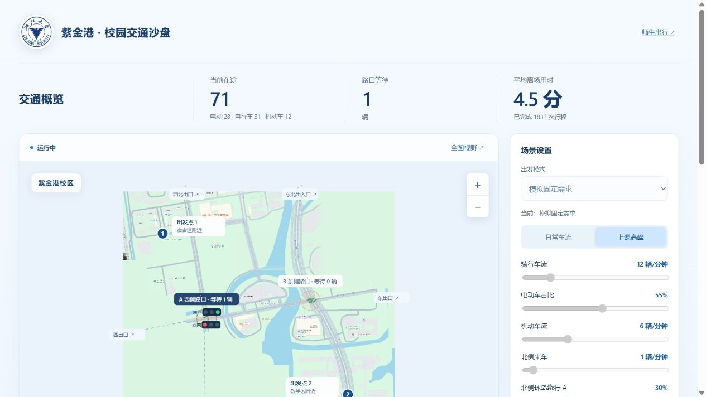
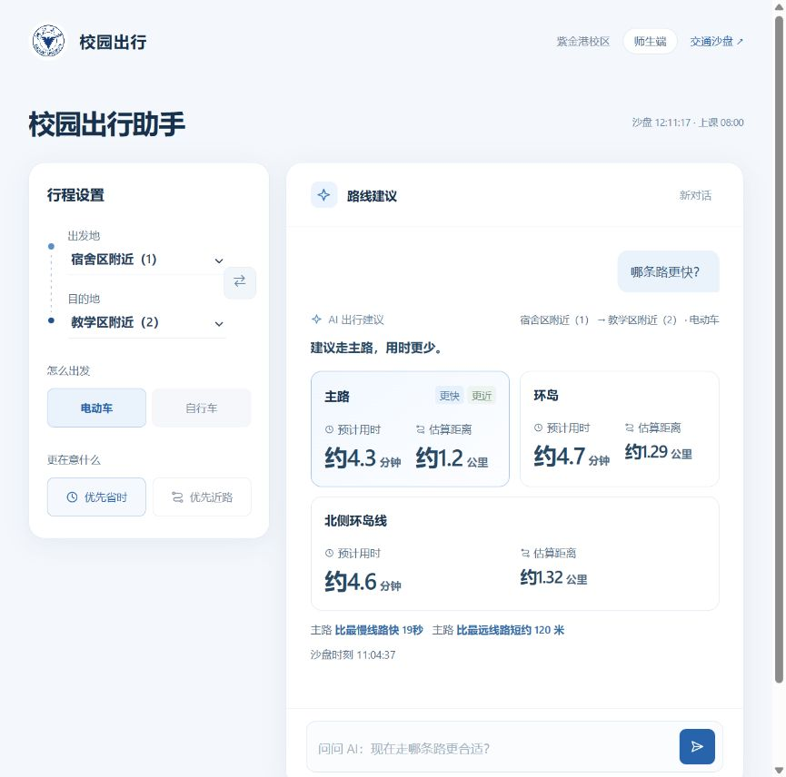

# 浙大校园交通 AI 预测预警系统

> 协作者指南 · 更新于 2026-10-18
>
> 阅读目标：使用最新 DeepSeek 分支在公网服务器部署，或在自己的电脑上运行平台。

这是面向浙江大学紫金港校区的校园交通模拟与 AI 辅助决策平台。当前已实现：

**管理员登录并调整交通策略 → 服务端共享沙盘推演 → 师生端读取同一份状态，由配置的学校 Dify 或 DeepSeek API 给出路线建议。**

管理员还可以直接向 AI 提出明确调参指令，或先查看优化方案、确认执行，再撤回上次调整。平台已有可运行网页和实际学校 AI 联调成果。

**所有路况仍为合成仿真。** 路线时间是规则估计，距离按主路约 1.2 公里近似换算；问卷用于构造模型，不代表校园全部人群或真实分钟流量。机器学习预测、真实信号硬件、真实课表和浙大钉通知尚未接入。

## 公网部署与最新分支

**请获取 `codex/deepseek-api` 分支，并先读 [给服务器 AI 的完整部署说明](DEPLOY_FOR_AI.md)。** 本版提供 Linux Docker + Caddy 公网入口，支持 DeepSeek、独立服务器管理员初始化和 HTTPS 代理；密钥由部署者自行填写。下方 Windows/学校 Dify 章节用于原本机部署，公网版本请以新说明为准。

DeepSeek 适配及独立两端真实问答已验证，见 [接入说明](ai-provider/README.md) 和 [真实 API 验收](ai-provider/REAL_API_VALIDATION.md)。完整出发推演依然由本地 Worker 计算，换模型不会让首次完整推演自动秒回。

## 2026-10-18 更新

- 师生端支持“早八几点出发”和避堵目标，后台用当前参数独立重建课前车流，返回出发时刻、用时和距离。见[完整推演与协作入口](dify-integration-lab/FORECAST_COLLABORATION.md)。
- 优化Worker车辆查询，保留原步长和规则。360人示例由179秒超时降至约63–70秒计算完成；首次完整推演仍非秒级。见[性能验证](dify-integration-lab/FORECAST_SPEED_VALIDATION.md)。
- 共用沙盘默认07:00–08:00，到点清理上一轮积压并回到07:00；保留管理员交通参数，管理员选择其他场景可覆盖。见[小时循环](traffic-sandbox/PUBLIC_HOUR_LOOP.md)。
- 两端共享地点别名和数据范围规则；缺少数据时不猜测未知地点或实际路况。普通快答、学校AI有界调度和访客只读权限保留。

仓库提供源码、测试和使用说明；学校API密钥、管理员账号、私钥和运行检查点由各部署者在本机配置，不在协作包内。

## 1. 已完成的成果

| 成果 | 协作者可以体验什么 | 说明与证据 |
| --- | --- | --- |
| 校园交通沙盘 | 三种车型在地图上行驶、排队、转向、并排超车，沿 19 条路径从 6 个出口离场 | [绕行与道路验收](traffic-sandbox/BYPASS_VALIDATION.md) |
| A 路口自动配时与北侧绕行 | 切换自动/固定配时，调整绕行策略，查看 A/B 排队变化与安全改道 | 管理员沙盘的场景设置、路口观察及信号面板 |
| 课前出发仿真 | 选择三个仿真时段和观察起点，查看此前已出发者、入口等待及平滑计划出发曲线 | [仿真模式说明](traffic-sandbox/QUESTIONNAIRE_DEPARTURES.md) |
| 认知与意愿分组 | 模拟学生是否知道路线、是否愿意尝试、是否获得引导，以及最终是否绕行 | [模型说明](traffic-sandbox/ROUTE_BEHAVIOR.md)、[最新验收](traffic-sandbox/ROUTE_BEHAVIOR_VALIDATION.md) |
| 管理员 AI 交通助手 | 分析拥堵、明确调参、提出并确认方案、撤回调整；窗口可拖动和归位 | [AI 接入验收](admin-access/AI_VALIDATION.md) |
| 师生 AI 出行助手 | 选择双向骑行行程，按省时/近路偏好比较主路、环岛、北侧环岛线 | [共享数据接入](dify-integration-lab/SANDBOX_VALIDATION.md) |
| 登录与访问权限 | 管理员登录后可控制；访客只能查看地图和使用师生问答 | [管理员说明](admin-access/README.md) |
| 一键启动与校园网访问 | 启动或复用四个服务，输出地址，核对沙盘与师生端共享状态 | [启动器说明](platform-launcher/README.md) |
| 画面流畅度优化 | 静态地图缓存、车辆沿道路连续插值，减少逐帧重复绘制 | [绘制优化](traffic-sandbox/RENDERING_VALIDATION.md)、[连续速度修正](traffic-sandbox/CONTINUOUS_SPEED_VALIDATION.md) |

当前 `package.json` 仍标为 0.12.0，但已经加入上述 10 月 14 日功能；最新仿真快照格式为 schema 16。不要只根据包版本号判断功能进度。

下面是已有实际网页验收截图，部分截图早于最新分组功能，完整界面以运行中的代码为准。图中数字只对应当次模拟状态。





### 最近的验收与模拟结果

最新认知与意愿分组验收记录汇总了 **109 项自动化检查通过**，并完成 **8 项真实学校 Dify 接口检查**、管理员网页方案确认/执行/撤回，以及正式师生路线问答。详见 [最新验收记录](traffic-sandbox/ROUTE_BEHAVIOR_VALIDATION.md)。

同需求、种子、车型和目的地的 15 分钟独立实验中，仅改变引导覆盖 0%/100%，两组均生成 505 辆车：

| 队列采样均值（辆） | 无引导 0% | 引导 100% |
| --- | ---: | ---: |
| A 路口 | 8.41 | 5.71 |
| B 路口 | 0.98 | 1.19 |
| 全部排队 | 9.39 | 6.90 |

这是指定参数下的模拟对照。A 压力减轻、B 略有增加，不能据此保证其它场景或真实校园的改善幅度。一次 AI 调参后的推荐变化，只能证明共享状态更新，不能代替因果对照实验。

## 2. 在协作者自己的电脑上部署

下面以 **Windows 电脑**为目标。先完成本机部署，再决定是否开放校园网访问。无需克隆 Git 仓库或安装第三方 npm 包，完整文件夹即可运行。

### 2.1 获取干净的项目副本

保留以下运行目录和资源：

- `traffic-sandbox/`，包含整个 `dist/`、地图资产、后端及工作线程。
- `dify-integration-lab/`、`admin-access/`、`admin-ai-design/`、`campus-access/`、`platform-launcher/`。
- 根目录的启动脚本、README；模型说明、测试及验收证据建议一并保留。

**分享时排除** `dify-integration-lab/.env.local`、整个 `admin-access/private/`、各级 `_backup*`、`.venv/`、`__pycache__/` 和日志。管理员私有目录含账号哈希、Dify 密钥、桥接密钥、TLS 私钥和内部检查点，应在新电脑重新生成或配置。

旧电脑的 `runtime.json`、`platform-launcher/last-start.json`、`launch.lock`、`平台访问地址.txt` 也不必随包分发，避免沿用旧地址与进程信息。`.gitignore` 不会替普通复制/压缩操作自动排除这些文件。

将副本解压到自己选定的目录。**下面所有命令均在该项目根目录的 PowerShell 中执行。** 不要直接双击 HTML 文件，也不要同时在同一电脑启动两份项目副本占用相同端口。

### 2.2 准备运行环境

| 环境 | 用途 |
| --- | --- |
| Node.js 20 或更新版本，命令 `node` 可用 | 仿真、AI 后端、登录与网关 |
| Python 3，含 venv 和 pip | 准备校园网 HTTPS 证书 |
| Python 库 `cryptography` | 生成项目自己的 CA 和 IP 证书 |
| Windows PowerShell、现代浏览器 | 启动、网络检查和网页体验 |

检查环境并创建项目虚拟环境：

```powershell
node --version
py -3 --version
py -3 -m venv .venv
.\.venv\Scripts\python.exe -m pip install cryptography
.\.venv\Scripts\python.exe -c "from cryptography import x509; print('Python依赖就绪')"
```

如果没有 `py`，但 `python` 已指向安装的 Python 3，可把上述 `py -3` 换为 `python`。使用虚拟环境的完整路径调用，不需要激活环境。JavaScript 服务无需执行 `npm install`。

### 2.3 配置两个 Dify 应用

**可以先跳过本步骤验证网页和沙盘。** 未配置密钥时，AI 会明确提示未就绪，不会使用假的回答替代。

完整 AI 体验需要学校 Dify 的两个已发布应用：师生应用和管理员应用。协作者应取得授权凭据，或在有权限的学校平台中新建对应应用，使用仓库中的当前提示词：

| 应用 | 当前提示词 | 本机配置位置 |
| --- | --- | --- |
| 师生路线助手 | [DIFY_STUDENT_PROMPT.txt](dify-integration-lab/DIFY_STUDENT_PROMPT.txt) | `dify-integration-lab/.env.local` |
| 管理员调控助手 | [DIFY_ADMIN_PROMPT.txt](admin-ai-design/DIFY_ADMIN_PROMPT.txt) | `admin-access/private/dify-admin.json` |

自行新建应用时，采用“开始 → LLM → 直接回复”，让 LLM 接收每轮 `sys.query` 的完整协议数据，关闭历史记忆，按当前提示词测试并发布。不要用普通聊天机器人提示词替代这些结构化协议；管理员已升级为 `campus-admin-v2`。可用模型与应用权限以学校平台为准。

师生端配置：

```powershell
.\dify-integration-lab\配置Dify.cmd
```

按提示填写学校应用的 API 基础地址和师生应用密钥；脚本隐藏密钥输入，保存为后端读取的 JSON 配置。

管理员配置：先创建目录并用记事本打开配置文件：

```powershell
New-Item -ItemType Directory -Force .\admin-access\private | Out-Null
notepad .\admin-access\private\dify-admin.json
```

保存为 UTF-8 JSON，结构如下，替换占位文字为自己获授权的管理员应用密钥：

```json
{
  "apiBase": "https://dify-api.zju.edu.cn/v1",
  "apiKey": "填写管理员应用的API密钥"
}
```

当前管理员后端只允许学校 `https://dify-api.zju.edu.cn/v1` 接口。不要把两个应用的密钥混用，也不要放入前端、README 或共享压缩包。调用学校 API 仍需要本机具备对应的校园网/VPN 可达性。

### 2.4 连接校园网并启动完整平台

电脑有校园网 **10.x IPv4** 地址时，使用下面这条命令：

```powershell
node .\platform-launcher\launch.mjs --python ".\.venv\Scripts\python.exe"
```

该命令使用刚建立的普通 Python 虚拟环境，**不要求安装原开发电脑的运行环境**。启动器会：

1. 识别当前校园网 IP，准备新电脑的桥接密钥和 HTTPS 证书。
2. 启动或复用沙盘、师生后端、管理员入口及校园网网关。
3. 缺少防火墙规则时请求 Windows 管理员授权，只放行校园网来源到 TCP 4180/4190。
4. 核对两端共享场景，输出地址，写入 `平台访问地址.txt`，并打开本机登录页。

原 **一键启动平台.cmd** 的 Python 路径仍指向开发电脑的捆绑环境；普通协作者电脑应优先使用上面的 `--python` 命令。它调用的是同一启动器，无需先改源码。

如果有多张 10.x 网卡，先将 `CAMPUS_HOST` 设置为这台电脑真实可用的校园网地址，再运行启动命令。没有 10.x 地址时，启动器会报错；只需在本机看页面的协作者可使用下一节。

### 2.5 不在校园网时：仅启动本机网页

本路径只启动本机三个服务，不启动校园网网关和 HTTPS 管理入口；用于本机查看、开发和美化页面。只需 Node.js，Python/证书准备可以之后再做。AI 仍需要学校接口可达。

先在项目根目录执行一次：

```powershell
node .\admin-access\server.mjs --prepare
```

再分别打开三个 PowerShell 窗口，每个窗口都进入项目根目录：

```powershell
# 窗口 1：共享沙盘
node .\traffic-sandbox\server.mjs
```

```powershell
# 窗口 2：师生出行后端
node .\dify-integration-lab\server.mjs
```

```powershell
# 窗口 3：仅本机管理员入口
$env:CAMPUS_HOST = '127.0.0.1'
node .\admin-access\server.mjs
```

第三个窗口的设置使管理员服务只提供本机入口，不尝试绑定校园网 HTTPS。窗口应保持打开，结束对应服务时按 `Ctrl+C`。

### 2.6 首次登录与访问地址

打开 [本机管理员登录](http://127.0.0.1:4174/login)，由新部署的服务器拥有者自行设置账号及 **12–128 位密码**。没有通用账号或默认密码，当前支持一个管理员账号。

| 入口 | 地址 | 权限 |
| --- | --- | --- |
| 本机管理与 AI 调参 | [http://127.0.0.1:4174/login](http://127.0.0.1:4174/login) | 登录后控制 |
| 本机访客沙盘 | [http://127.0.0.1:4173/viewer/](http://127.0.0.1:4173/viewer/) | 只读 |
| 本机师生问答 | [http://127.0.0.1:4183/student/](http://127.0.0.1:4183/student/) | 查询路线 |
| 校园网沙盘/师生端 | 启动输出的 `http://当前IP:4180/`、`/student/` | 访客与师生 |
| 校园网管理员 | 启动输出的 `https://当前IP:4190/login` | 登录后控制 |

`4173/` 会跳转登录，`4183/` 会跳转师生端；旧 A/B 联调首页已退场。校园网地址必须使用自己电脑本次启动的输出，不能照抄截图中的旧 IP。

其它设备通过校园网 HTTPS 登录管理前，需核对并安装**新服务器生成的项目 CA 公钥证书**；步骤见 [管理员证书说明](admin-access/README.md)。不要安装另一份项目副本的旧证书，也不要忽略证书错误后输入密码。普通师生使用 HTTP 4180 无需安装管理员证书。

### 2.7 部署成功检查

依次确认：

- 访客页可以加载地图和车流，缩放可用，策略控件不可操作。
- 管理员登录后能调整绕行、暂停和播放；师生端读取同一场景。
- 选择“仿真模式”、时段和观察起点后，场景会自动准备并重新开始；较晚起点可能等待十余秒，应出现准备状态。
- 配置 AI 后，师生问“哪条路更快？”可返回三路线建议；管理员明确调参有真实回执，建议须确认才生效，撤回可用。
- 开放校园网后，在另一台设备分别检查地图和问答；远程管理员还需完成证书和登录检查。

新电脑首次启动的是初始场景，**不会复制原电脑正在运行的车辆、统计或登录会话**。已有完整检查点和恢复工具用于人工部署，尚无自动保存、故障守护或断电恢复保证。

### 常见问题

| 情况 | 处理 |
| --- | --- |
| `node`、`py` 找不到 | 安装相应环境，重新打开 PowerShell；Python 也可使用已确认的 `python` 命令 |
| 提示找不到 Python 或缺少 cryptography | 使用 `--python ".\.venv\Scripts\python.exe"`，并在该环境安装依赖 |
| 没有 10.x 地址 | 使用仅本机启动流程，或连接校园网；不要伪造校园网地址 |
| 端口被其它程序占用 | 确认 4173/4174/4180/4183/4190 的占用者；启动器不会强行终止其它程序 |
| AI 显示未连接 | 检查对应应用是否发布、密钥是否匹配、学校 API 是否可达 |
| 本机能看、其它设备打不开 | 检查防火墙授权、当前 IP 和校园网设备隔离，不能据本机成功保证全校可达 |
| 页面已关闭，车流还在运行 | 仿真在后端推进；管理员点击暂停。启动器的后台服务不会随窗口关闭而退出 |

完整启动器路径运行后，**停止校园网访问.cmd** 停止校园网及管理员入口，但保留沙盘和师生后端；**停止管理员登录.cmd** 只停止管理员入口。重新联网后再次运行启动命令，查看最新地址。

## 3. 建议协作者先演示这条流程

1. 在管理端观察地图、A/B 队列、红绿灯和北侧绕行。
2. 切换到“仿真模式”，选择 07:00–08:00、09:00–10:00 或 13:00–14:00，并选择观察起点。模式、时段、观察起点改变会自动重启场景；“模拟固定需求”隐藏时钟。
3. 在“选路规则”启用“认知与意愿分组”，调整引导覆盖，观察认知、触达和实际绕行的差别。**此项不会清空或重启车流**，与出发场景切换不同。
4. 打开可拖动的“交通助手”，先问原因，再提出待确认方案；执行后查看回执、控件同步，再撤回。
5. 在师生端选择电动车或自行车，问省时/近路问题；方案变化后重新查询，看到同源状态下的新建议。
6. 导出当前仿真数据，结合模型说明理解统计口径。

问卷有效样本为 36 份；当前平滑出发曲线是额外模型假设，不再严格保持原出发时间类别比例。内部演示总人数默认 360，不是实测校园人数。引导覆盖也不是实际接受率；分组中的概率、节省门槛与人群迁移假设见 [路线行为模型](traffic-sandbox/ROUTE_BEHAVIOR.md)。撤回设置不会让已收到信息的学生“忘记路线”。

管理员 AI 保留原七项参数，在分组启用时额外允许调整引导覆盖；选路模式、问卷权重及行为假设仍只读。师生端目前支持双向骑行三路线，不提供步行或未来出发时刻预测。

## 4. 下一步重点：网站页面美化

2026-10-14 已完成本轮 **管理沙盘、师生端、登录页与 AI 面板**的统一视觉整理：地图图例移到画面外，控件和数字更加清楚，师生推荐路线优先展示，手机布局与 AI 窗口裁边完成浏览器核查。截图、测试、限制和回退位置见 [Taste 界面验收](TASTE_UI_VALIDATION.md)。实体手机、虚拟键盘与跨设备完整操作仍需实测。

### 视觉方向

继续使用浙江大学校徽与蓝色主题，以校园地图和真实运行的车流作为管理端主体。建议统一六个基础颜色：深蓝 `#184F87`、交互蓝 `#2F77BC`、页面底色 `#F5F8FC`、白色 `#FFFFFF`、主文字 `#20384F`、次文字 `#5A7084`。

统一中文字体、标题/正文/数字字号、间距、按钮高度、圆角与边框；优先使用本机中文字体，避免页面依赖外网字体加载。数值使用等宽数字对齐，信息以左对齐为主。车型蓝/紫/红、等待橙色和红黄绿灯继续表达原有含义，地图影像保持原色。

### 本轮完成情况与后续工作

| 优先级 | 任务 | 具体改进 | 验收目标 |
| --- | --- | --- | --- |
| 已完成 | 统一视觉规范 | 整理四个界面的蓝白颜色、中文字号、间距、按钮、表单和焦点，替换多轮重复覆盖 | 核心文字对比度与主要44px操作区已检查 |
| 已完成 | 管理端布局 | 图例移出地图，宽屏地图保持可见，减少留白，保留四板块顺序和全部管理统计 | 两种桌面尺寸下播放区可见，访客只读 |
| 已完成 | 师生路线结果 | 推荐路线先展示并明确标记，另两路线可比较，估算数据仍来自同轮沙盘 | 正式学校 AI 查询和手机中文发送通过 |
| 已完成 | AI 窗口与登录页 | 统一聊天、变更清单与执行/撤回，使用校园路网静态示意，修正手机浮窗裁边 | 隔离执行/撤回、键盘归位和登录焦点通过 |
| 待实测 | 实体手机 | 390px 浏览器布局已完成；继续检查真实触屏、虚拟键盘和地址栏变化 | 输入、发送和地图手势可用，浮层不遮挡操作 |
| P1 | 图表与状态细节 | 补足曲线单位、当前值和范围，区分计划出发与实际入场，整理加载/断连/重查提示 | 图表口径清楚，场景准备后恢复操作，错误时可重试 |
| P1 | 演示收尾 | 固定一条完整演示路线，整理截图与介绍文案 | 页面适合录屏，讲述成果与限制均有依据 |

美化时保留服务端共享状态、登录权限、匿名只读、自动场景切换、AI 方案确认和撤回。管理端保留转向、变道/超车、安全改道与配时原因；师生端继续聚焦行程与建议。固定模式的时钟仍隐藏，仿真模式才显示，不能为了视觉统一把它们全部加回。

车辆的显示缓冲与静态地图缓存已存在；动画只服务于车流和交互反馈。不要用大量装饰动画、滤镜或阴影增加地图绘制负担。先整理现有 HTML/CSS/JavaScript，再评估是否需要额外组件或依赖。

### 美化主要修改哪些文件

| 页面/模块 | 前端入口 |
| --- | --- |
| 管理沙盘 | [index.html](traffic-sandbox/dist/index.html)、[style.css](traffic-sandbox/dist/style.css)、[app.mjs](traffic-sandbox/dist/app.mjs) |
| 管理登录与已登录页样式 | [login.html](admin-access/public/login.html)、[login.css](admin-access/public/login.css)、[admin.css](admin-access/public/admin.css) |
| 管理员 AI 面板 | [admin-ai.html](admin-access/public/admin-ai.html)、[admin-ai.css](admin-access/public/admin-ai.css)、[admin-ai.mjs](admin-access/public/admin-ai.mjs) |
| 师生端 | [student/index.html](dify-integration-lab/public/student/index.html)、[student/style.css](dify-integration-lab/public/student/style.css)、[student/app.mjs](dify-integration-lab/public/student/app.mjs) |

本轮静态资源已经更新，刷新页面即可查看。修改前副本位于 `_backup/20261014-231113-before-taste-redesign/`，桌面和手机截图保存在 `ui-validation/taste/`。继续修改现有文件前仍需留可恢复版本；后端或协议变更应按对应部署流程验证。

### 页面美化完成的标准

- 1280×900、1440×900 和 390×844 三种尺寸检查截图，布局完整、文字不截断，浮层不遮挡主要控制。
- 地图资源在登录与访客入口均能加载；鼠标、触屏、键盘焦点、中文输入和发送操作可用。
- 暂停/播放、场景自动切换、观察起点、认知分组、方案确认/撤回、师生重新查询均按原规则工作。
- UI 修改不重置正在运行的仿真、不改变参数，不把访客控件变成可操作；控制仍由后端鉴权。
- 浏览器无新增错误；动效尊重减少动态效果设置。浏览器手机尺寸检查完成后，再做实体手机验收。

页面美化之后，继续推进启动/恢复稳定性、数据校准和小范围试用，冻结版本，再录制 Apple 发布会风格的比赛演示视频。正式介绍需补入最新成果，当前 `项目介绍.docx` 仍是较早阶段文稿。

## 5. 项目目录与协作约定

```text
项目根目录/
├─ README.md                   本文：成果、部署与页面美化分工
├─ platform-launcher/          四服务启动、地址输出与共享状态检查
├─ traffic-sandbox/            路网、引擎、共享仿真、场景与管理网页
├─ dify-integration-lab/        师生网页、学校 AI 接口与路线校验
├─ admin-access/               登录、HTTPS、管理员 AI 与前端资源
├─ admin-ai-design/            当前管理员协议、提示词与输出校验
├─ campus-access/              校园网只读网关
├─ route-behavior-review/       路线行为设计与对照材料
├─ Map.png / 地图素材/          底图与参考素材
├─ 浙大校园AI创新应用大赛/      官方通知、申报、分工等资料
├─ AGENT.md / AGENTS.md         项目背景与 AI 助手工作要求
└─ _backup*/                   原电脑的恢复副本，不随分享包分发
```

道路与仿真见 [route.mjs](traffic-sandbox/dist/route.mjs)、[engine.mjs](traffic-sandbox/dist/engine.mjs)；共享状态见 [shared-simulation.mjs](traffic-sandbox/shared-simulation.mjs)；师生路线估计见 [student-data.mjs](traffic-sandbox/student-data.mjs)。页面美化不应另建一套浏览器仿真或把人工样例重新接回产品页面。

本 README 的部署命令已核对启动器 `--python` 支持，并验证隔离目录的首次证书生成及 12 项现有启动器测试。**尚未在协作者的实体电脑上完成整套部署验收**；部署成功后应按本文件检查清单实测。没有调用学校模型或修改原服务器正在运行的场景来验证本次文档。

校园网已有另一台设备打开地图的确认，但不保证所有楼宇/网段可达；远程管理员证书安装与实体手机完整操作仍需继续验收。当前没有公网部署、自动持久化或学校统一认证。

AI 助手开始工作前阅读 [AGENT.md](AGENT.md)。团队同步修改时注明文件与范围，交付页面修改、截图、验证结果和恢复位置。比赛申报中的个人信息、管理员账号和私有凭据不要进入公开截图或代码样例。

2026-10-15 已加入全站GSAP动效：地图定位、交通助手、路线结果、参数回执、场景布局、行程选择及登录入场。构建见 [ui-motion/README.md](ui-motion/README.md)，验收与本次沙盘服务中断后的新建场景说明见 [SITE_MOTION_VALIDATION.md](SITE_MOTION_VALIDATION.md)。


## DeepSeek 独立接入测试

已增加可选择的 DeepSeek API 适配和两端提示词加载。默认学校 Dify 接入保留；双击 `启动DeepSeek独立测试.cmd` 可运行独立测试站点（本机4283，独立车流与管理员Cookie）。真实 API 密钥需要自行填写，尚未宣称真实 DeepSeek 联调或公网部署完成。配置、提示词、测试与限制见 [ai-provider/README.md](ai-provider/README.md)。
